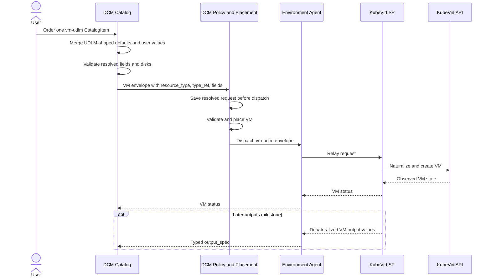

# Aligning DCM with UDLM

## Open Questions

1. Should DCM introduce two VM ServiceTypes (Candidate A: `vm` for OSAC and
   `vm-udlm` for KubeVirt), or distinguish contract versions under `vm`
   (Candidate B)? The proposal and JSON below show Candidate A, but the
   transition design is not decided. OSAC must keep working.
2. Under Candidate A, how will an immutable ServiceType binding support a later
   UDLM schema version while preserving retries of orders saved with the old
   `type_ref`? The design must define how new orders select a version and how
   the corresponding schema and provider remain available for saved orders.

### Related Jira Tickets

| Ticket                                                                                                                                                                                         | Relation                                                 |
| ---------------------------------------------------------------------------------------------------------------------------------------------------------------------------------------------- | -------------------------------------------------------- |
| [FLPATH-4436](https://redhat.atlassian.net/browse/FLPATH-4436)                                                                                                                                 | Epic: align DCM types with UDLM                          |
| [FLPATH-4793](https://redhat.atlassian.net/browse/FLPATH-4793)                                                                                                                                 | This enhancement                                         |
| [FLPATH-4654](https://redhat.atlassian.net/browse/FLPATH-4654)                                                                                                                                 | Test the alignment                                       |
| [FLPATH-4491](https://redhat.atlassian.net/browse/FLPATH-4491)                                                                                                                                 | Finalize UDLM; v1 proceeds against pinned schemas        |
| [FLPATH-4298](https://redhat.atlassian.net/browse/FLPATH-4298), [FLPATH-4748](https://redhat.atlassian.net/browse/FLPATH-4748), [FLPATH-4749](https://redhat.atlassian.net/browse/FLPATH-4749) | Coordinate VM output definitions and delivery            |
| [FLPATH-4767](https://redhat.atlassian.net/browse/FLPATH-4767)                                                                                                                                 | KubeVirt SP transport work; separate from the data model |

## Summary

This enhancement uses UDLM `Machine.VM` fields from DCM's catalog and policy
through the KubeVirt provider, without translating old DCM VM requests. In the
DCM request, `resource_type: Machine.VM` names the UDLM class and `type_ref`
pins its UDLM schema version. V1 supports CPU, memory, guest OS, and temporary
disks while keeping OSAC VM orders working. The choice of one or two VM
ServiceTypes remains open; UDLM-aligned observed outputs follow in a separate
milestone.

## Motivation

[UDLM (Universal Data Lifecycle Model)](https://github.com/dcm-project/udlm/blob/51784e84be49684cfd2f4138c5ea0c511bceaaba/README.md)
defines portable resource schemas; `Machine.VM` is its VM class. DCM uses
ServiceTypes to define orderable resource contracts and service providers (SPs)
to fulfill requests on infrastructure. OSAC is an existing provider that uses
DCM's current VM contract; KubeVirt SP is the provider adopting UDLM in v1.

DCM and UDLM describe VMs differently. For example, DCM uses `vcpu`, while UDLM
`Machine.VM` uses `cpu`. This makes it harder to use one portable VM contract
across providers and to align VM requests and observed outputs with UDLM.
KubeVirt VM orders should use the UDLM model, while existing OSAC VM orders must
keep working. DCM will not translate legacy VM requests into UDLM.

### Goals

- Use the supported subset of the pinned UDLM `Machine.VM` spec for the KubeVirt
  VM path from CatalogItem resolution through policy, placement, and dispatch.
- Keep the current OSAC VM request usable during the transition. If the two
  ServiceTypes are chosen, keep `vm` for OSAC and use `vm-udlm` for KubeVirt,
  with no cross-routing.
- Add VM policies for the UDLM field paths, such as `fields.cpu.count`. Keep
  existing OSAC VM policies on their current field paths.
- Reject a VM request if no available provider supports its contract.
- Let one VM CatalogItem define UDLM VM fields, including disk defaults and
  which values users may edit.
- Save the final VM spec after applying user values, so retries use what the
  user ordered even if the CatalogItem changes later.
- Keep temporary disks for KubeVirt VMs. Data persistence across VM stop,
  restart, or deletion is not guaranteed; boot disks must still meet the
  requested-size rule.
- Validate the complete resolved `fields` object against the pinned UDLM class
  schema and DCM v1 rules before dispatch. KubeVirt SP must honor supported OS,
  disk sizes, and any supplied disk role; reject unsupported values before
  creating a VM.
- Map UDLM VM requests to KubeVirt resources inside KubeVirt SP (naturalize).
  Map observed KubeVirt state to UDLM-aligned output values (denaturalize) as
  the outputs path supports them.
- Keep one pinned JSON contract at the DCM-to-provider boundary and test both
  sides against it.

### Non-Goals

- Changing OSAC SP or adding more SPs to the UDLM VM path in v1.
- Creating a second user-facing CatalogItem for the VM's disks.
- Persistent VM disks, retained data, and a `Retain`/`Delete` choice. These need
  a separate epic for Volume creation, attachment, and lifecycle.
- Replacing DCM's catalog, policy engine, placement service, or transport. Their
  rules and checks still need to support the new VM request.
- Defining a new UDLM type. Any needed UDLM schema change is a separate,
  versioned dependency.
- Adopting complete UDLM state records or aligning non-VM ServiceTypes in v1.

### Storage retention (future epic)

V1 disks are temporary; data persistence across VM stop, restart, or deletion is
not guaranteed. Deleting a VM removes its temporary disks. DCM will not offer a
retention setting or create UDLM `Volume` resources for VM disks in v1.

Persistent VM storage needs a separate epic. That work must define how DCM
creates and tracks Volumes, how KubeVirt attaches durable disks, what happens
when a VM is deleted, and how users find and reuse retained data. UDLM's
`Volume.reclaim_policy` (`Retain` or `Delete`) belongs to that future work.

## Proposal

The sections below describe **Candidate A: two ServiceTypes**. This is a
proposed transition, not a decision. Open Question 1 must be resolved before
implementation. If another option is chosen, revise the ServiceType name,
examples, routing, tests, and rollout plan together. The UDLM VM contract does
not depend on that choice.

### Contract and ownership

Under Candidate A, DCM would add a `vm-udlm` ServiceType with a DCM envelope.
The existing `vm` ServiceType and its schema would stay available for OSAC:

| Part                        | Owner                   | Purpose                                          |
| --------------------------- | ----------------------- | ------------------------------------------------ |
| `service_type`, `metadata`  | DCM                     | Routing and DCM name/labels                      |
| `resource_type`, `type_ref` | DCM ServiceType binding | UDLM class name and exact pinned schema identity |
| `fields`                    | UDLM `Machine.VM.spec`  | VM values, including inline `disks[]`            |

`fields` is one generic name for UDLM-aligned ServiceTypes; v1 uses it only for
`Machine.VM`. It contains instance values, not all UDLM definitions and not a
complete UDLM state record. For example, `fields.cpu.count` belongs to the
`Machine.VM` spec. DCM's `service_type` chooses the catalog, policy, and
eligible provider; `resource_type` chooses the UDLM class schema. `type_ref`
identifies its exact version.

DCM must add immutable `resource_type` and `type_ref` binding fields to the
ServiceType API and storage. They do not exist on today's ServiceType. The
`vm-udlm` definition binds `Machine.VM` to
`https://udlm.dev/registry/udlm/1.0/Machine.VM/2.4.2`. DCM copies that binding
into each resolved request. The catalog author declares defaults and edit rules
for `metadata.*` and `fields.*`. At order time, users may change only fields
marked editable. Neither can set or replace the type binding. DCM's current
`ServiceType.spec` is a value template, not a full JSON Schema validator. The
new path must validate the **complete resolved** `fields` object against the
pinned generated `Machine.VM.spec` schema and its referenced definitions. The
schema URL is an identity; validation uses the pinned local schema bundle, not a
runtime fetch. DCM then applies its own v1 requirements and KubeVirt capability
checks.

For example, the new ServiceType definition carries this binding (fragment of
the proposed ServiceType API, not a complete create request):

```json
{
  "service_type": "vm-udlm",
  "resource_type": "Machine.VM",
  "type_ref": "https://udlm.dev/registry/udlm/1.0/Machine.VM/2.4.2"
}
```

The CatalogItem is the reusable template. DCM resolves and validates the VM
values, then saves the complete request, including `fields` and its disk list,
before dispatch. Retries reuse that saved request rather than rebuild it from an
edited CatalogItem. Open Question 2 covers how to preserve saved orders when a
later schema version is introduced.

### V1 supported fields and validation

KubeVirt v1 supports only `fields.cpu.count`, `fields.memory.size`,
`fields.guest_os.type`, and `fields.disks[].name/size/role`. Reject every other
valid `Machine.VM` field or subfield until it has explicit KubeVirt support.
Passing UDLM schema validation does not mean a request is supported by the
provider.

After validating the complete resolved `fields` against the pinned schema, DCM
applies these v1 requirements: `cpu.count`, `memory.size`, `guest_os.type`, and
a nonempty `disks` list must be present. Each disk must have a unique name and a
nonzero size. Reject missing names or sizes and malformed values. The UDLM disk
definition makes `role` optional and describes at most one `boot` role. DCM
rejects multiple explicit boot roles, but does not require a boot role. KubeVirt
must honor a supplied role or reject the request before creating a VM. If every
disk omits `role`, KubeVirt uses the first disk as its boot disk. If some disks
have explicit non-boot roles but none has `role: "boot"`, KubeVirt rejects the
request; it must not silently boot from a disk marked as non-boot. KubeVirt
rejects any role or disk setting it does not support. The UDLM class schema
allows the top-level fields above to be absent, so their required presence is a
DCM v1 rule.

### Candidate A: parallel VM ServiceTypes during transition

The existing `vm` ServiceType keeps the DCM VM schema, OSAC CatalogItems, and
legacy policy paths. The new `vm-udlm` ServiceType has separate KubeVirt
CatalogItems and UDLM policy paths. A CatalogItem names one ServiceType, so DCM
validates and places each request against its own schema. The provider receives
that same format.

KubeVirt advertises `vm-udlm` through the Environment Agent; OSAC keeps its
direct control-plane registration for `vm`. Extend agent registration to pair
each UDLM-aligned ServiceType with the exact `type_ref` versions it supports.
Placement and dispatch require a ready provider advertising both `vm-udlm` and
the request's `type_ref`. A missing or empty version list does not match.
KubeVirt SP also checks `resource_type` and `type_ref` before creating a VM and
rejects an unsupported version. If no compatible ready provider is available,
the request fails; registration, retry, and fallback must not cross the two VM
contracts.

Users will see two VM types during the transition. Moving OSAC to UDLM and
retiring legacy `vm` are later decisions, not part of this v1 change.

| Concern                         | Legacy `vm` (OSAC)                            | New `vm-udlm` (KubeVirt)                                             |
| ------------------------------- | --------------------------------------------- | -------------------------------------------------------------------- |
| VM fields in catalog and policy | DCM `vcpu`, `storage.disks`                   | UDLM `fields.cpu`, `fields.disks`                                    |
| Disk defaults                   | Inline `storage.disks` on an OSAC CatalogItem | Inline `fields.disks` on a KubeVirt CatalogItem                      |
| Disk identity after order       | Disk names in VM spec                         | Resolved `fields.disks[].name` in each VM order                      |
| Provider mapping                | DCM VM fields to OSAC                         | UDLM VM spec to KubeVirt                                             |
| Provider result                 | Existing OSAC status behavior                 | Status at launch; typed `output_spec` in the later outputs milestone |

### Field comparison between separate contracts

These fields belong to different ServiceTypes. Existing `vm` fields stay as they
are.

| Legacy `vm` field          | New `vm-udlm` field            | Rule                                      |
| -------------------------- | ------------------------------ | ----------------------------------------- |
| `vcpu.count`               | `fields.cpu.count`             | Legacy field stays on `vm`                |
| `memory.size`              | `fields.memory.size`           | Use UDLM quantity validation              |
| `guest_os.type`            | `fields.guest_os.type`         | Keep OS selection in the VM fields        |
| `storage.disks[].name`     | `fields.disks[].name`          | Stable per-VM disk identity               |
| `storage.disks[].capacity` | `fields.disks[].size`          | Honor the requested size                  |
| Disk named `boot`          | Optional `fields.disks[].role` | Honor or reject a supplied boot role      |
| `service_type`, `metadata` | Same DCM envelope              | Keep outside the UDLM VM fields           |
| No UDLM type binding       | `resource_type`, `type_ref`    | DCM sets these from the ServiceType       |
| `provider_hints.osac`      | Not used in v1                 | Retain only for legacy OSAC `vm` requests |

### Candidate A example: one KubeVirt VM CatalogItem

This example describes **target v1 behavior**. KubeVirt SP needs changes for the
selected OS image and disk sizes before the CatalogItem can be published.

This **proposed** JSON assumes Candidate A. In this example, the catalog author
marks the disk list as not editable and lets the user change the VM name. That
is a choice for this CatalogItem, not a UDLM requirement. Another CatalogItem
could let users replace the disk list; DCM must validate the final list.
`fields[].path` must be valid against the new DCM VM envelope schema. The
CatalogItem's `fields[]` list declares defaults and edit rules; the resolved
request's `fields` object holds the actual UDLM VM values.

```json
{
  "api_version": "v1alpha1",
  "display_name": "Development VM",
  "spec": {
    "resources": [
      {
        "name": "vm",
        "service_type": "vm-udlm",
        "fields": [
          { "path": "metadata.name", "editable": true, "default": "new-vm" },
          { "path": "fields.cpu.count", "editable": false, "default": 2 },
          {
            "path": "fields.memory.size",
            "editable": false,
            "default": "8Gi"
          },
          {
            "path": "fields.guest_os.type",
            "editable": false,
            "default": "rhel-9"
          },
          {
            "path": "fields.disks",
            "editable": false,
            "default": [
              { "name": "root", "size": "50Gi", "role": "boot" },
              { "name": "data", "size": "100Gi", "role": "data" }
            ]
          }
        ]
      }
    ]
  }
}
```

Assume DCM returns the CatalogItem UID `catalog-item-123`. The user orders this
**one** `vm-udlm` CatalogItem by that UID. No separate storage order is needed.
The order request is:

```json
{
  "api_version": "v1alpha1",
  "display_name": "Web VM",
  "spec": {
    "catalog_item_id": "catalog-item-123",
    "user_values": [
      { "resource": "vm", "path": "metadata.name", "value": "web-01" }
    ]
  }
}
```

An OSAC CatalogItem instead continues to use `service_type: vm` and legacy DCM
field paths such as `vcpu.count` and `storage.disks`.

### Candidate A example: resolved VM request

After catalog resolution, DCM keeps the resolved VM values and disks with the
order. The following **proposed** HTTP body is what DCM sends to KubeVirt SP at
`POST /api/v1alpha1/vms?id=vm-123`. The outer `spec` is the SP API's resource
body. Inside it, `fields` contains the UDLM `Machine.VM.spec` values. DCM sets
`resource_type` and `type_ref` from the ServiceType binding; they are not user
values. No separate disk-layout record is needed.

```json
{
  "spec": {
    "service_type": "vm-udlm",
    "metadata": { "name": "web-01" },
    "resource_type": "Machine.VM",
    "type_ref": "https://udlm.dev/registry/udlm/1.0/Machine.VM/2.4.2",
    "fields": {
      "cpu": { "count": 2 },
      "memory": { "size": "8Gi" },
      "guest_os": { "type": "rhel-9" },
      "disks": [
        { "name": "root", "size": "50Gi", "role": "boot" },
        { "name": "data", "size": "100Gi", "role": "data" }
      ]
    }
  }
}
```

The proposed `vm-udlm` v1 envelope does not accept `provider_hints`. Legacy OSAC
`vm` requests keep `provider_hints.osac`. Before rollout, the published
CatalogItem and example must use a proven supported OS and disk-size
combination. Unsupported values must fail before a VM is created; the provider
must not silently substitute an OS or disk size. The implementation work below
describes the current provider gaps.

### VM request and result flow



### User Stories

#### Story 1: Order a VM

A user chooses one `vm-udlm` CatalogItem and sets only fields the catalog author
made editable. The disk list starts with the CatalogItem's defaults. If the
author marks it editable, the user may replace the whole list. DCM validates the
final list before sending the VM request to a provider. An OSAC user can still
order a legacy `vm` CatalogItem.

#### Story 2: Apply VM policy

A policy author for `vm-udlm` reads the same UDLM-shaped VM fields that KubeVirt
SP receives. For example, CPU policy reads `fields.cpu.count`. Existing `vm`
policies retain their DCM field paths. DCM still uses `service_type`, metadata,
and placement context for its own decisions.

#### Story 3: Read VM outputs

A user reads the VM's status and typed output values, such as `primary_ip` and
`hostname`, through DCM after the output milestone lands. The provider supplies
these values after observing the VM; they are not predicted from the request.

### Implementation Details/Notes/Constraints

- Add `vm-udlm` to the DCM allowed ServiceType names and public API schema. Add
  its catalog defaults, policies, seed data, and public client support. Keep the
  existing `vm` schema, OSAC CatalogItems, and policy paths unchanged. Check UI,
  CLI, status, and outputs code for assumptions that every VM has the literal
  `service_type: vm`.
- Add immutable `resource_type` and `type_ref` fields to the DCM ServiceType API
  and storage. Bind `vm-udlm` to the pinned `Machine.VM` class; store the
  generated schema and its referenced definitions in a versioned DCM bundle.
  Copy the binding into the resolved request and SP body. Do not treat the
  ServiceType's existing `spec` value template as a JSON Schema validator.
- Add full-object validation against the pinned generated `Machine.VM.spec`
  schema and its referenced definitions. Enforce the
  [v1 supported fields and validation rules](#v1-supported-fields-and-validation)
  before dispatch.
- Accept catalog defaults only on declared fields and user values only on
  editable fields. Reject client-supplied `resource_type` or `type_ref` and
  mixed legacy VM fields. Reject a schema-version mismatch before dispatch.
- Update the KubeVirt SP request contract to receive the proposed
  `{ "spec": { ..., "fields": { ... } } }` body. It must map supported
  `Machine.VM` values to KubeVirt resources and reject unsupported values before
  creating a VM. It must honor or reject any supplied disk role; disk position
  or name must not override an explicit role. The current boot `ContainerDisk`
  has no requested capacity, while data `EmptyDisk` is fixed at 10Gi. V1 must
  honor a requested size or reject a size it cannot prove. The 50Gi boot example
  must work before that CatalogItem is published. Map `rhel-9` to a real
  available image before publishing it. Never silently use CirrOS or a different
  disk size.
- The Environment Agent remains a relay for KubeVirt and advertises `vm-udlm`.
  OSAC keeps its direct control-plane SP registration for `vm`; its future agent
  migration is separate. Extend agent registration with the exact `type_ref`
  versions supported for each UDLM-aligned ServiceType. A missing or empty
  version list cannot qualify for `vm-udlm`. Placement and dispatch check the
  exact pair; registration, retry, and fallback must not route either request to
  the other VM contract.
- Reuse the typed `output_spec` status path proposed in
  [cross-provider-outputs PR #99](https://github.com/dcm-project/enhancements/pull/99).
  Define VM output fields against the pinned UDLM `Machine.VM` names:
  `provider_handle`, `primary_ip`, `hostname`, `ip_addresses`, `mac_addresses`,
  `observed_run_state`, and `target_segment`. Adding these observed values is a
  separate milestone, not a prerequisite for the `vm-udlm` launch. Do not invent
  a value KubeVirt cannot observe. Volume-related outputs belong to the future
  storage epic.
- UDLM `Machine.VM.spec.disks` describes requested disk shape, not persistent
  storage. Follow the [temporary-storage scope](#storage-retention-future-epic).

### Risks and Mitigations

| Risk                                                            | Mitigation                                                                            |
| --------------------------------------------------------------- | ------------------------------------------------------------------------------------- |
| A legacy `vm` policy is applied to `vm-udlm` or vice versa      | Scope policies by exact ServiceType; test a rejecting policy for each path            |
| Catalog defaults or user values mix the two VM shapes           | Validate each CatalogItem against its own ServiceType schema                          |
| A request reaches the wrong provider, including during fallback | Match exact advertised ServiceType at placement and dispatch; fail closed             |
| A provider accepts a newer VM schema it cannot handle           | Match pinned `type_ref` at readiness and dispatch; reject mismatch before create      |
| An empty ready-agent list bypasses capability validation        | Require a compatible ready provider for `vm-udlm` before dispatch                     |
| UI, CLI, or outputs omit `vm-udlm` because they check only `vm` | Audit VM-specific filters, views, and output paths for both ServiceTypes              |
| The VM disk list is absent, malformed, or changed on retry      | Validate complete `fields`; reuse the saved resolved request                          |
| UDLM-valid fields are silently ignored by KubeVirt              | Enforce the v1 supported subset before VM creation                                    |
| KubeVirt ignores requested OS, size, or boot role               | Prove the example's OS and boot/data sizes work; reject unsupported requests          |
| Users expect disk data to survive VM stop, restart, or deletion | State that v1 disks are temporary; track persistence and retention in a separate epic |
| UDLM changes after implementation starts                        | Pin `type_ref` and release commit; review and test each version bump                  |
| VM outputs conflict with the outputs enhancement                | Reuse its typed `output_spec` and align definitions to pinned UDLM names              |

## Design Details

### Work sequence

If Candidate A is selected:

1. Pin the UDLM VM class schema and define the DCM `fields` envelope, immutable
   `resource_type`/`type_ref` binding, and v1 supported subset.
2. Add `vm-udlm` to allowed ServiceType names and define its catalog paths,
   policies, defaults, full-object validator, and clients. Preserve legacy `vm`.
3. Save each resolved `fields` object, including inline disks, for the order.
   Pass the same request through policy, placement, retry, and dispatch.
4. Update the DCM and KubeVirt SP request contracts, image selection, and
   temporary-disk behavior. Advertise the exact supported
   `(service_type, type_ref)` and reject unsupported values before creating a
   VM. Output population follows the separate outputs work.
5. Verify a successful `vm-udlm` order with the requested OS and disk sizes,
   plus a legacy `vm` OSAC order and cross-routing failure cases, before
   rollout.

### Versioning

Pin the
[`udlm/1.0-rc1` release](https://github.com/dcm-project/udlm/releases/tag/1.0-rc1)
at commit `51784e84be49684cfd2f4138c5ea0c511bceaaba`. Its
[generated VM schema](https://github.com/dcm-project/udlm/blob/1.0-rc1/registry/generated/machine.vm.json)
ID is `https://udlm.dev/registry/udlm/1.0/Machine.VM/2.4.2`. Volume and
StorageLayout are outside this enhancement's v1 scope.

`udlm/1.0` identifies the framework spec, while `2.4.2` identifies the
`Machine.VM` class. This is a release candidate, not final 1.0. `Machine.VM`
remains experimental, so DCM cannot assume its shape is stable. Record the
release commit, exact `type_ref`, and referenced schema definitions in DCM and
KubeVirt SP. KubeVirt must declare support for that exact pin. A later UDLM
change needs a coordinated versioning plan and validation run. Open Question 2
must resolve how new versions coexist with the immutable ServiceType binding and
saved orders; changing the pin in place is not a defined upgrade path. Retries
must continue to use their saved contract. A separate shared Go SDK is not
required for v1; future VM providers can use the same versioned JSON contract
without sharing implementation code.

### Testing Strategy

These checks describe Candidate A. UDLM validation, disk, and KubeVirt
fulfillment checks are needed under either transition design. If the team
chooses another way to keep OSAC working, revise the provider-isolation tests
before implementation.

Extend the existing KubeVirt API and full catalog E2E tests in
`dcm-project/utilities/tests/e2e/`, the Control Plane catalog and SP subsystem
tests, and KubeVirt SP mapper and handler tests. Reuse their current helpers and
generated clients. Update the older KubeVirt test plan's PVC expectations to
match this v1 temporary-disk scope; current E2E tests check `ContainerDisk` but
do not prove the requested OS image or disk sizes.

- Validate `vm` CatalogItems against the unchanged DCM schema and `vm-udlm`
  CatalogItems against the new DCM envelope. After resolution, validate the
  complete `fields` object against the pinned UDLM `Machine.VM.spec` schema,
  including referenced definitions; reject unknown and malformed fields. Confirm
  each CatalogItem's disk edit rules are enforced and clients cannot set or
  change the ServiceType's `resource_type` or `type_ref`.
- Check separate policy paths for both ServiceTypes. Include a policy that must
  reject a request of each type so a missing Rego field cannot pass unnoticed.
- Check that DCM v1 rejects missing `cpu.count`, `memory.size`, `guest_os.type`,
  absent or empty `fields.disks`, missing disk names or sizes, duplicate names,
  multiple explicit boot roles, zero/invalid sizes, and unsupported VM fields or
  subfields before dispatch. The UDLM class schema does not require these
  top-level fields; these are DCM v1 rules. Check that KubeVirt honors or
  rejects an explicit boot role when it conflicts with disk position or name.
  Check the first-disk default when all roles are absent and rejection when a
  disk has an explicit non-boot role but no disk has `role: "boot"`. Rejected
  requests must create no VM. Test idempotent retry with the same saved resolved
  `fields`.
- Verify the full CatalogItem → CatalogItemInstance → ServiceTypeInstance →
  KubeVirt flow for `vm-udlm`, plus a legacy `vm` order to OSAC. Run both paths
  in one deployment. Check OSAC's direct registration and KubeVirt's agent
  discovery, including re-registration, missing providers, an empty ready-agent
  list, an empty `type_ref` capability list, retry, and no cross-type fallback.
  Check the actual RHEL 9 image and realized boot and data disk sizes in the
  successful example. Check boot capacity from the image or guest-visible disk,
  since `ContainerDisk` has no capacity field. An unsupported OS, field, disk
  setting, or `type_ref` must fail before VM creation and leave no VM or
  temporary disk resources. Verify VM deletion removes the VM and its temporary
  disk resources. Persistence and `Retain`/`Delete` tests belong to the separate
  storage epic.
- Check naturalization against pinned schemas. Reject unknown guest OS and
  unsupported VM fields or disk settings instead of silently choosing defaults.
  Check `vm-udlm` v1 rejects provider hints, while legacy OSAC hints still work.
  Reject a `resource_type` or `type_ref` mismatch at DCM and SP. Verify status
  when `vm-udlm` launches and, separately, populated UDLM output fields as the
  outputs milestone lands. Verify existing OSAC status and output behavior
  remains unchanged.

### Upgrade / Downgrade Strategy

DCM is in development, with no saved VM requests requiring data migration. Under
Candidate A, add the `vm-udlm` binding, `fields` validator, catalog and policy
path, local API types, and KubeVirt SP alongside the unchanged legacy `vm` path
for OSAC. Do not route an order until KubeVirt advertises or is gated to the
exact `(vm-udlm, type_ref)` contract and a supported CatalogItem example has
passed end to end. During rollback, stop new `vm-udlm` orders and settle already
created KubeVirt VMs before removing its schema or provider; legacy OSAC `vm`
orders continue. Do not send either request to the other path. If Candidate A is
not selected, revise this plan.

## Implementation History

N/A — this enhancement has not been implemented.

## Drawbacks

This needs coordinated API/storage changes for the ServiceType binding, a new
full-object validator in catalog resolution, changes across policy and
placement, provider capability checks, and KubeVirt SP before the new VM request
works. KubeVirt also needs working temporary boot media and an OS image mapping
for the example. Candidate A keeps two VM schemas, CatalogItems, and policy
paths until OSAC migrates. That adds maintenance but keeps OSAC VM ordering
available.

## Alternatives

### Candidate B: Version both contracts under `service_type: vm`

#### Description

Keep one public `vm` ServiceType name but require a contract identifier on each
CatalogItem and provider. Use it to choose the schema, policy paths, and
compatible provider. This would move the immutable UDLM binding proposed for
Candidate A from the ServiceType to a more specific catalog contract. The
request would still carry the resolved `resource_type` and `type_ref`; their
source, validation, and storage would need a separate design.

#### Pros

- Users would see one VM type.
- Provider capabilities could express contract versions directly.

#### Cons

- The catalog currently resolves one schema by ServiceType name, so validation
  and resolution would need a larger redesign.
- A single ServiceType cannot bind both legacy DCM VM and UDLM `Machine.VM` to
  one immutable `type_ref`; the binding must be selected at a lower level.
- Every placement, retry, and fallback path would need version-aware checks.

#### Status

Under consideration while Open Question 1 is unresolved.

#### Rationale

This would keep one public VM type, but DCM currently resolves one schema by
ServiceType name and filters providers by ServiceType. It therefore requires
version-aware catalog validation and routing. Candidate A is easier to isolate
and verify, but neither candidate has been selected yet.

## Infrastructure Needed

No new runtime infrastructure or shared SDK repository is required for inline VM
disk intent. Durable disk support and its KubeVirt volume lifecycle belong to
the separate storage epic.
