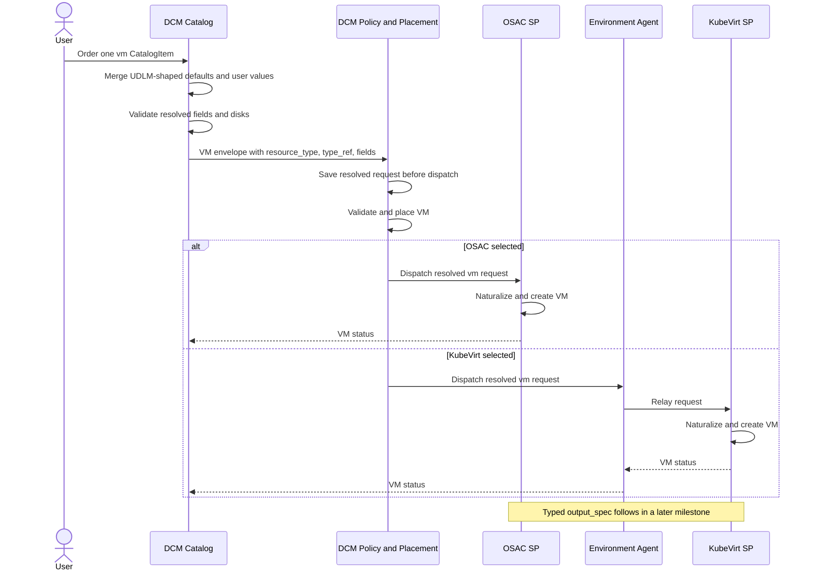

# Aligning DCM with UDLM

## Open Questions

N/A — the v1 `vm` contract and provider scope are decided.

### Related Jira Tickets

| Ticket                                                                                                                                                                                         | Relation                                                 |
| ---------------------------------------------------------------------------------------------------------------------------------------------------------------------------------------------- | -------------------------------------------------------- |
| [FLPATH-4436](https://redhat.atlassian.net/browse/FLPATH-4436)                                                                                                                                 | Epic: align DCM types with UDLM                          |
| [FLPATH-4793](https://redhat.atlassian.net/browse/FLPATH-4793)                                                                                                                                 | This enhancement                                         |
| [FLPATH-4654](https://redhat.atlassian.net/browse/FLPATH-4654)                                                                                                                                 | Test the alignment                                       |
| [FLPATH-4491](https://redhat.atlassian.net/browse/FLPATH-4491)                                                                                                                                 | Finalize UDLM; v1 proceeds against pinned schemas        |
| [FLPATH-4298](https://redhat.atlassian.net/browse/FLPATH-4298), [FLPATH-4748](https://redhat.atlassian.net/browse/FLPATH-4748), [FLPATH-4749](https://redhat.atlassian.net/browse/FLPATH-4749) | Coordinate VM output definitions and delivery            |
| [FLPATH-4767](https://redhat.atlassian.net/browse/FLPATH-4767)                                                                                                                                 | KubeVirt SP transport work; separate from the data model |

## Summary

This enhancement changes DCM's existing `vm` ServiceType to use UDLM
`Machine.VM` fields from the catalog through provider dispatch. Both OSAC and
KubeVirt service providers will accept the same pinned VM request contract and
map it to their own infrastructure. V1 covers CPU, memory, guest OS, and disks;
UDLM-aligned observed outputs follow in a separate milestone.

## Motivation

[UDLM (Universal Data Lifecycle Model)](https://github.com/dcm-project/udlm/blob/51784e84be49684cfd2f4138c5ea0c511bceaaba/README.md)
defines portable resource schemas; `Machine.VM` is its VM class. DCM uses
ServiceTypes to define orderable resource contracts and service providers (SPs)
to fulfill requests on infrastructure. OSAC and KubeVirt are two providers for
the existing DCM `vm` ServiceType.

DCM and UDLM describe VMs differently. For example, DCM uses `vcpu`, while UDLM
`Machine.VM` uses `cpu`. This makes it harder to use one portable VM contract
across providers and to align VM requests and observed outputs with UDLM. One
UDLM-shaped `vm` request lets DCM use the same field paths for both providers.

### Goals

- Use the supported subset of the pinned UDLM `Machine.VM` spec for the existing
  `vm` ServiceType, from CatalogItem resolution through provider dispatch.
- Change VM catalog and policy paths to UDLM fields, such as `fields.cpu.count`.
- Update both OSAC and KubeVirt SPs to accept the same request envelope and
  naturalize `fields` to their own infrastructure.
- Reject a VM request if no available provider supports its contract.
- Let one VM CatalogItem define UDLM VM fields, including disk defaults and
  which values users may edit.
- Save the final VM spec after applying user values, so retries use what the
  user ordered even if the CatalogItem changes later.
- Keep KubeVirt v1 disks temporary. Their data persistence across VM stop,
  restart, or deletion is not guaranteed; boot disks must still meet the
  requested-size rule.
- Validate the complete resolved `fields` object against the pinned UDLM class
  schema and DCM v1 rules before dispatch. Each SP must honor the values it
  supports or reject the request before creating a VM.
- Map UDLM VM requests to native resources inside each SP (naturalize). Map
  observed native state to UDLM-aligned output values (denaturalize) when the
  outputs path supports them.
- Use one pinned JSON contract at both provider boundaries and test DCM and both
  SPs against it before release.

### Non-Goals

- Creating a second user-facing CatalogItem for the VM's disks.
- Defining persistent VM disks, retained data, or a `Retain`/`Delete` choice
  across providers. These need a separate epic for Volume creation, attachment,
  and lifecycle.
- Replacing DCM's catalog, policy engine, placement service, or transport. Their
  rules and checks still need to support the new VM request.
- Defining a new UDLM type. Any needed UDLM schema change is a separate,
  versioned dependency.
- Adopting complete UDLM state records or aligning non-VM ServiceTypes in v1.

### Storage retention (future epic)

KubeVirt v1 disks are temporary; data persistence across VM stop, restart, or
deletion is not guaranteed. Deleting a KubeVirt VM removes its temporary disks.
This enhancement does not define a cross-provider retention setting or create
UDLM `Volume` resources for VM disks in v1.

Persistent VM storage needs a separate epic. That work must define how DCM
creates and tracks Volumes, how providers attach durable disks, what happens
when a VM is deleted, and how users find and reuse retained data. UDLM's
`Volume.reclaim_policy` (`Retain` or `Delete`) belongs to that future work.

## Proposal

DCM changes the existing `vm` ServiceType in place. Its CatalogItems, policies,
resolved orders, and provider requests use UDLM `Machine.VM` field paths. Both
OSAC and KubeVirt SPs implement this contract. There is one VM ServiceType and
one request format for both providers.

This is a development-stage cutover. `vm` orders may fail while DCM and the two
SPs are being updated. Both providers must pass the pinned contract before the
new `vm` path is released.

### Contract and ownership

DCM keeps a DCM request envelope around the UDLM VM values:

| Part                        | Owner                   | Purpose                                          |
| --------------------------- | ----------------------- | ------------------------------------------------ |
| `service_type`, `metadata`  | DCM                     | Routing and DCM name/labels                      |
| `resource_type`, `type_ref` | DCM ServiceType binding | UDLM class name and exact pinned schema identity |
| `fields`                    | UDLM `Machine.VM.spec`  | VM values, including inline `disks[]`            |

`fields` contains one VM's UDLM spec values. It is not a complete UDLM state
record. For example, `fields.cpu.count` belongs to `Machine.VM.spec`. DCM's
`service_type: vm` selects the catalog and policy contract. Placement chooses a
provider that supports that contract. `resource_type: Machine.VM` names the UDLM
class, and `type_ref` identifies its exact version.

DCM must add immutable `resource_type` and `type_ref` binding fields to the
ServiceType API and storage. They do not exist on today's ServiceType. The `vm`
definition binds `Machine.VM` to
`https://udlm.dev/registry/udlm/1.0/Machine.VM/2.4.2`. DCM copies that binding
into each resolved request. This `type_ref` is the `$id` in the
[pinned generated VM schema](https://github.com/dcm-project/udlm/blob/51784e84be49684cfd2f4138c5ea0c511bceaaba/registry/generated/machine.vm.json),
not a hosted schema download. DCM validates against its pinned local schema
bundle, including referenced definitions; it does not fetch that ID at runtime.

The catalog author declares defaults and edit rules for `metadata.*` and
`fields.*`. At order time, users may change only fields marked editable. Neither
can set or replace the type binding. DCM's current `ServiceType.spec` is a value
template, not a full JSON Schema validator. The new path must validate the
**complete resolved** `fields` object against the pinned generated
`Machine.VM.spec` schema. DCM then applies its own v1 requirements before
dispatch. Each SP checks its supported values before creating a VM.

The updated `vm` ServiceType definition carries this binding (fragment of the
proposed ServiceType API, not a complete create request):

```json
{
  "service_type": "vm",
  "resource_type": "Machine.VM",
  "type_ref": "https://udlm.dev/registry/udlm/1.0/Machine.VM/2.4.2"
}
```

The CatalogItem is the reusable template. DCM resolves and validates the VM
values, then saves the complete request, including `fields` and its disk list,
before dispatch. Retries reuse that saved request rather than rebuild it from an
edited CatalogItem. A later schema version needs a separate design.

### V1 supported fields and validation

DCM v1 accepts only `fields.cpu.count`, `fields.memory.size`,
`fields.guest_os.type`, and `fields.disks[].name/size/role`. Reject every other
valid `Machine.VM` field or subfield until both providers have a defined way to
handle it. Passing UDLM schema validation alone does not mean a provider can
fulfill the request.

After validating the complete resolved `fields` against the pinned schema, DCM
applies these v1 requirements: `cpu.count`, `memory.size`, `guest_os.type`, and
a nonempty `disks` list must be present. Each disk must have a unique name and a
nonzero size. Reject missing names or sizes and malformed values. The UDLM disk
definition makes `role` optional and describes at most one `boot` role. DCM
rejects multiple explicit boot roles, but does not require a boot role. Each SP
must honor a supplied role or reject the request before creating a VM. If every
disk omits `role`, both SPs use the first disk as boot. If a disk has an
explicit non-boot role but no disk has `role: "boot"`, a provider rejects the
request rather than silently booting from a disk marked as non-boot. Each SP
rejects values it does not support. Rejection means an error before VM creation,
not a substituted default. The UDLM class schema allows the top-level fields
above to be absent, so their required presence is a DCM v1 rule.

### Provider compatibility

OSAC keeps its direct control-plane registration; KubeVirt uses the Environment
Agent. Each registration must declare support for the exact `(vm, type_ref)`
pair. Placement and dispatch require a ready provider with that pair. A missing
or empty version list does not match. Both SPs check `resource_type` and
`type_ref` and reject an unsupported version before creating a VM. The single
`vm` name does not choose a provider; placement still chooses one.

Matching a schema version does not prove that a provider can fulfill every value
in that schema. DCM accepts only its v1 field subset. If placement selects an SP
that cannot fulfill a value, it rejects the request before VM creation. DCM
returns the error; it does not silently send that request to another SP. OSAC
selects its template and instance type inside the SP from the requested CPU,
memory, guest OS, and provider configuration. If there is no match or more than
one match, OSAC returns an error without creating a VM. The common request has
no `provider_hints` field. OSAC must implement this mapping before release.

### Field comparison: current DCM to proposed UDLM VM

These are changes to one `vm` contract. The old paths do not remain as a second
active VM request format.

| Current `vm` field         | Proposed `vm` field            | Rule                                 |
| -------------------------- | ------------------------------ | ------------------------------------ |
| `vcpu.count`               | `fields.cpu.count`             | Use the UDLM CPU name                |
| `memory.size`              | `fields.memory.size`           | Use UDLM quantity validation         |
| `guest_os.type`            | `fields.guest_os.type`         | Keep OS selection in the VM fields   |
| `storage.disks[].name`     | `fields.disks[].name`          | Keep per-VM disk names               |
| `storage.disks[].capacity` | `fields.disks[].size`          | Honor or reject the requested size   |
| Disk named `boot`          | Optional `fields.disks[].role` | Honor or reject a supplied boot role |
| `service_type`, `metadata` | Same DCM envelope              | Keep outside UDLM VM fields          |
| No UDLM type binding       | `resource_type`, `type_ref`    | DCM sets these from `vm`             |

### Example: one VM CatalogItem

This example describes **target v1 behavior**, not values the current providers
already support. Both SPs need to prove they can fulfill a published
CatalogItem's values or reject unsupported requests before creating a VM.

The catalog author marks the disk list as not editable and lets the user change
the VM name. That is a choice for this CatalogItem, not a UDLM requirement.
Another CatalogItem could let users replace the disk list; DCM must validate the
final list. Neither example disk sets a role, so both SPs use the first disk as
boot. `fields[].path` must be valid against the new DCM VM envelope schema. The
CatalogItem's `fields[]` list declares defaults and edit rules; the resolved
request's `fields` object holds the actual UDLM VM values.

```json
{
  "api_version": "v1alpha1",
  "display_name": "Development VM",
  "spec": {
    "resources": [
      {
        "name": "vm",
        "service_type": "vm",
        "fields": [
          { "path": "metadata.name", "editable": true, "default": "new-vm" },
          { "path": "fields.cpu.count", "editable": false, "default": 2 },
          {
            "path": "fields.memory.size",
            "editable": false,
            "default": "8Gi"
          },
          {
            "path": "fields.guest_os.type",
            "editable": false,
            "default": "rhel-9"
          },
          {
            "path": "fields.disks",
            "editable": false,
            "default": [
              { "name": "root", "size": "50Gi" },
              { "name": "data", "size": "100Gi" }
            ]
          }
        ]
      }
    ]
  }
}
```

Assume DCM returns the CatalogItem UID `catalog-item-123`. The user orders this
**one** `vm` CatalogItem by that UID. No separate storage order is needed. The
order request is:

```json
{
  "api_version": "v1alpha1",
  "display_name": "Web VM",
  "spec": {
    "catalog_item_id": "catalog-item-123",
    "user_values": [
      { "resource": "vm", "path": "metadata.name", "value": "web-01" }
    ]
  }
}
```

### Example: resolved VM request

After catalog resolution, DCM keeps the resolved VM values and disks with the
order. This is the logical VM body delivered to either selected SP. OSAC's
direct route and KubeVirt's Environment Agent route use the same resolved
contract. The outer `spec` is the SP resource body. Inside it, `fields` contains
the UDLM `Machine.VM.spec` values. DCM sets `resource_type` and `type_ref` from
the ServiceType binding; they are not user values. No separate disk-layout
record is needed.

```json
{
  "spec": {
    "service_type": "vm",
    "metadata": { "name": "web-01" },
    "resource_type": "Machine.VM",
    "type_ref": "https://udlm.dev/registry/udlm/1.0/Machine.VM/2.4.2",
    "fields": {
      "cpu": { "count": 2 },
      "memory": { "size": "8Gi" },
      "guest_os": { "type": "rhel-9" },
      "disks": [
        { "name": "root", "size": "50Gi" },
        { "name": "data", "size": "100Gi" }
      ]
    }
  }
}
```

Before release, the published CatalogItem and example must use a proven
supported OS and disk-size combination for every provider eligible to receive
it. Unsupported values must fail before a VM is created; no provider may
silently substitute an OS or disk size. The implementation work below describes
the current provider gaps. The shared `vm` request does not carry
`provider_hints`; OSAC selects provider-specific values inside the SP.

### VM request and result flow



### User Stories

#### Story 1: Order a VM

A user chooses one `vm` CatalogItem and sets only fields the catalog author made
editable. The disk list starts with the CatalogItem's defaults. If the author
marks it editable, the user may replace the whole list. DCM validates the final
list before sending the VM request to a provider.

#### Story 2: Apply VM policy

A policy author for `vm` reads the same UDLM-shaped VM fields that the SP
receives. For example, CPU policy reads `fields.cpu.count`. DCM still uses
`service_type`, metadata, and placement context for its own decisions.

#### Story 3: Read VM outputs

A user reads the VM's status and typed output values, such as `primary_ip` and
`hostname`, through DCM after the output milestone lands. The provider supplies
these values after observing the VM; they are not predicted from the request.

### Implementation Details/Notes/Constraints

- Change the existing `vm` ServiceType schema, CatalogItems, seed data,
  policies, public API, and clients to use UDLM VM field paths. Update UI and
  CLI VM forms and examples. Remove old VM field paths rather than keeping a
  second active request format.
- Add immutable `resource_type` and `type_ref` fields to the DCM ServiceType API
  and storage. Bind `vm` to the pinned `Machine.VM` class; store the generated
  schema and its referenced definitions in a versioned DCM bundle. Copy the
  binding into the resolved request and SP body. Do not treat the ServiceType's
  existing `spec` value template as a JSON Schema validator.
- Add full-object validation against the pinned generated `Machine.VM.spec`
  schema and its referenced definitions. Enforce the
  [v1 supported fields and validation rules](#v1-supported-fields-and-validation)
  before dispatch.
- Accept catalog defaults only on declared fields and user values only on
  editable fields. Reject client-supplied `resource_type` or `type_ref` and
  legacy VM fields. Reject a schema-version mismatch before dispatch. Save the
  complete resolved request so a retry does not rebuild it from changed
  CatalogItem defaults.
- Update OSAC SP to accept the proposed `{ "spec": { ..., "fields": { ... } } }`
  body. It must map CPU, memory, guest OS, and disks to OSAC resources. It
  selects its template and instance type inside the SP from those VM values and
  provider configuration, without `provider_hints` in the shared request. Its
  current boot-disk-by-name behavior must change to honor a supplied UDLM role
  or use the first disk as boot when every role is absent. OSAC must reject
  values it cannot fulfill and missing or ambiguous template mappings before
  creating a VM.
- Update KubeVirt SP to accept the same body and map supported `Machine.VM`
  values to KubeVirt resources. It must honor or reject any supplied disk role;
  disk position or name must not override an explicit role. Its current boot
  `ContainerDisk` has no requested capacity, while each data `EmptyDisk` is
  fixed at 10Gi. V1 must honor a requested size or reject a size it cannot
  prove. The 50Gi boot example must work before that CatalogItem is published.
  Map `rhel-9` to a real available image before publishing it. Never silently
  use CirrOS or a different disk size.
- OSAC keeps direct control-plane registration; KubeVirt keeps the Environment
  Agent as its relay. Extend both registration paths to advertise the exact
  `type_ref` versions supported for `vm`. A missing or empty version list does
  not qualify. Placement and dispatch check the exact `(vm, type_ref)` pair and
  fail if no compatible ready provider exists. Each SP rejects an unsupported
  `resource_type` or `type_ref` before creating a VM.
- Reuse the typed `output_spec` status path proposed in
  [cross-provider-outputs PR #99](https://github.com/dcm-project/enhancements/pull/99).
  Define VM output fields against the pinned UDLM `Machine.VM` names:
  `provider_handle`, `primary_ip`, `hostname`, `ip_addresses`, `mac_addresses`,
  `observed_run_state`, and `target_segment`. Adding these observed values is a
  separate milestone, not a prerequisite for the `vm` contract launch. Each SP
  reports only values it can observe. Volume-related outputs belong to the
  future storage epic.
- UDLM `Machine.VM.spec.disks` describes requested disk shape, not persistent
  storage. Follow the [storage scope](#storage-retention-future-epic).

### Risks and Mitigations

| Risk                                                 | Mitigation                                                                     |
| ---------------------------------------------------- | ------------------------------------------------------------------------------ |
| DCM changes `vm` before both SPs are ready           | Accept temporary development failures; gate release on both provider paths     |
| Old catalog or policy paths silently miss new fields | Change all VM paths together; test a policy that must reject a request         |
| A provider accepts a schema version it cannot handle | Match pinned `(vm, type_ref)` at readiness and dispatch; reject mismatch       |
| A selected provider cannot fulfill a valid VM value  | Reject before VM creation; return an error without silent provider fallback    |
| No ready provider passes the capability check        | Fail the request before dispatch; never skip the check for an empty list       |
| The VM disk list is malformed or changes on retry    | Validate complete `fields`; reuse the saved resolved request                   |
| OSAC uses an unrelated template or disk layout       | Map UDLM VM values through provider configuration; reject unsupported values   |
| KubeVirt ignores requested OS, size, or boot role    | Prove the actual OS and disk sizes; reject unsupported values before creation  |
| KubeVirt disk data is mistaken for retained storage  | State its temporary-disk behavior; track persistent storage in a separate epic |
| UDLM changes after implementation starts             | Pin `type_ref` and release commit; review and test each version bump           |
| VM outputs conflict with the outputs enhancement     | Reuse its typed `output_spec` and pinned UDLM names                            |

## Design Details

### Work sequence

1. Pin the UDLM VM class schema and define the DCM `fields` envelope, immutable
   `resource_type`/`type_ref` binding, and v1 supported subset.
2. Change the existing `vm` schema, CatalogItems, policy paths, clients, and
   full-object validator. Save the resolved request, including inline disks, for
   policy, placement, retry, and dispatch.
3. Update both SPs against the same pinned request. OSAC maps VM values to its
   template and instance type; KubeVirt updates image and disk handling. Each
   provider advertises `(vm, type_ref)` and rejects unsupported values before VM
   creation. The two SP changes can proceed in parallel once the contract is
   fixed.
4. Verify a successful `vm` order through each SP with actual OS and disk
   values, plus invalid-field, provider-unavailable, and retry cases. Release
   only after DCM and both SPs pass the contract. Output population follows the
   separate outputs work.

### Versioning

Pin the
[`udlm/1.0-rc1` release](https://github.com/dcm-project/udlm/releases/tag/1.0-rc1)
at commit `51784e84be49684cfd2f4138c5ea0c511bceaaba`. Its
[generated VM schema](https://github.com/dcm-project/udlm/blob/1.0-rc1/registry/generated/machine.vm.json)
ID is `https://udlm.dev/registry/udlm/1.0/Machine.VM/2.4.2`. Volume and
StorageLayout are outside this enhancement's v1 scope.

`udlm/1.0` identifies the framework spec, while `2.4.2` identifies the
`Machine.VM` class. This is a release candidate, not final 1.0. `Machine.VM`
remains experimental, so DCM cannot assume its shape is stable. Record the
release commit, exact `type_ref`, and referenced schema definitions in DCM and
both SPs. Both SPs must declare support for that exact pin. A later UDLM change
needs a coordinated versioning plan and validation run in a separate design.
Saved orders must keep their original contract; changing the `vm` pin in place
is not a defined upgrade path. A separate shared Go SDK is not required for v1;
both providers can use the same versioned JSON contract without sharing
implementation code.

### Testing Strategy

Extend the existing Control Plane catalog and provider subsystem tests, both SP
test suites, and Utilities end-to-end VM tests. Reuse their established helpers,
fixtures, and generated clients. Test the same pinned `vm` contract through OSAC
and KubeVirt before release. Current KubeVirt tests do not prove the requested
OS image or disk sizes, and older PVC expectations must match this enhancement's
temporary-disk scope.

- Resolve a `vm` CatalogItem with defaults and editable user values. Validate
  the complete `fields` object against the pinned UDLM schema and DCM v1 rules.
  Reject unknown fields, malformed quantities, missing CPU, memory, guest OS or
  disks, duplicate disk names, invalid sizes, and multiple explicit boot roles
  before dispatch. Reject user changes to `resource_type` or `type_ref` and
  provider hints in the shared request.
- Check that VM policies use the new `fields.*` paths. Include a policy that
  must reject a request, so a missed field path cannot silently allow it.
- Check OSAC direct registration and KubeVirt agent registration with the exact
  `(vm, type_ref)` pair. Missing providers, empty capability lists, and version
  mismatches must fail before dispatch. Retry must reuse the saved resolved
  request even when CatalogItem defaults have changed. A provider rejection must
  return an error without silently dispatching to another provider.
- Run the full CatalogItem to VM flow through each SP in one deployment. Verify
  each provider uses the requested OS and disk sizes or rejects unsupported
  values before VM creation. Check OSAC template and instance-type selection
  from VM fields and provider configuration, including missing and ambiguous
  mappings. Check KubeVirt boot and data disks, including the realized size of
  boot media, which has no requested-capacity field in the current
  `ContainerDisk` implementation.
- Check that each SP honors or rejects explicit disk roles. When every role is
  omitted, verify that each SP uses the first disk as boot. A request with an
  explicit non-boot role and no boot role must fail without creating a VM.
  Reject an unsupported OS, disk setting, `resource_type`, or `type_ref` without
  silently using another value or leaving partial resources.
- Verify VM status for both providers. Test populated UDLM output fields when
  the separate outputs milestone lands. Verify KubeVirt VM deletion removes its
  temporary disks; persistence and retention tests belong to the storage epic.

### Upgrade / Downgrade Strategy

DCM is in development, with no saved VM orders requiring data migration. Change
the existing `vm` contract in place across DCM and both SPs. VM orders may fail
while those changes are in progress; do not release this intermediate state.
Release only when DCM, OSAC, and KubeVirt accept the exact pinned contract and
both provider paths pass end to end. A rollback restores a compatible set of DCM
and SP versions together; do not run one side with the other side's schema. If
saved VM orders exist by the time this is implemented, revisit migration before
rollout. A later UDLM version needs its own upgrade design.

## Implementation History

N/A — this enhancement has not been implemented.

## Drawbacks

The in-place change can interrupt VM orders during development. DCM, OSAC, and
KubeVirt must move together before release. Both SPs need their own mapping from
the shared UDLM VM request, and provider differences can still make some
CatalogItem values unavailable on one provider. KubeVirt also needs boot media
and OS image mapping that can meet the example's requested values. These costs
avoid maintaining two active VM request contracts.

## Alternatives

### Keep both VM request formats during the cutover

#### Description

Keep the old DCM VM request and the new UDLM request active under `vm` during
implementation. Each CatalogItem and provider would declare which version it
supports; DCM would choose validation, policy paths, and routing by version.

#### Pros

- OSAC orders could keep working while KubeVirt adopts the new request.
- DCM could move CatalogItems to UDLM one at a time.

#### Cons

- DCM would need version-aware catalog validation, policy, placement, and
  retries under one ServiceType name.
- Both request formats and their tests would remain active during the cutover.

#### Status

Not selected for this development-stage cutover.

#### Rationale

The project can accept temporary VM failures during development and has no saved
VM orders to migrate. The extra version-aware DCM work is not needed for this
first cutover. Future UDLM version upgrades remain an open design question.

## Infrastructure Needed

No new runtime infrastructure or shared SDK repository is required. Both SPs
need their own provider configuration and access to their VM backends. Durable
disk support and its provider volume lifecycle belong to the separate storage
epic.
